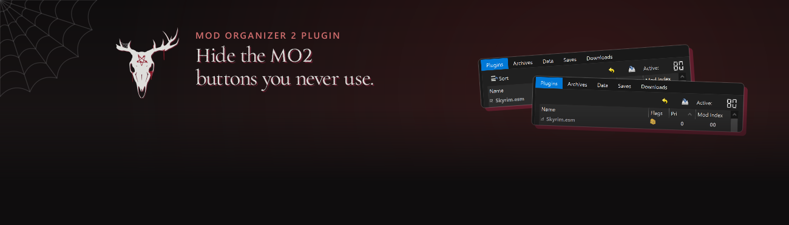
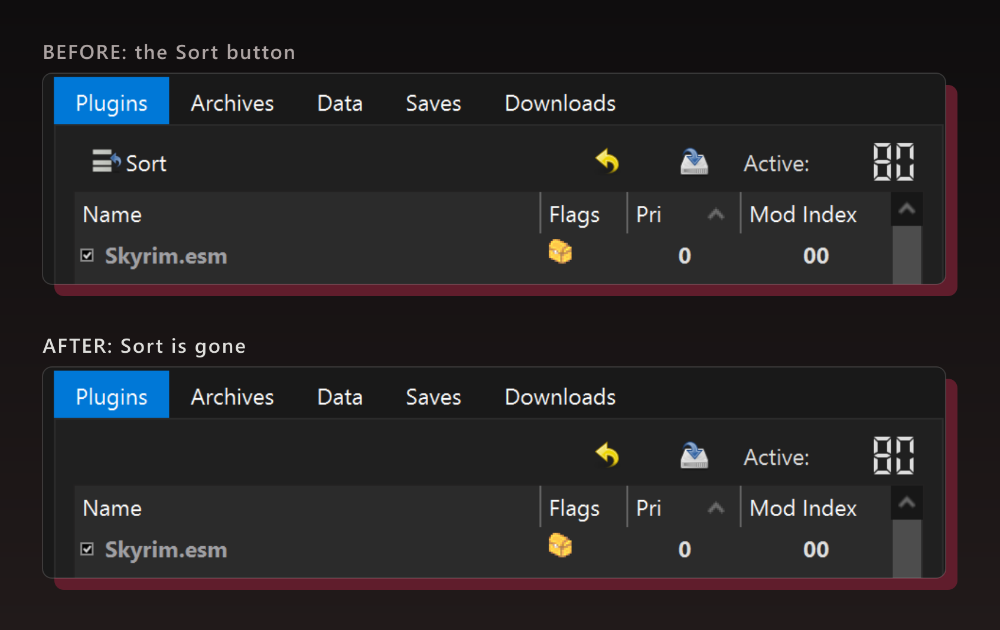
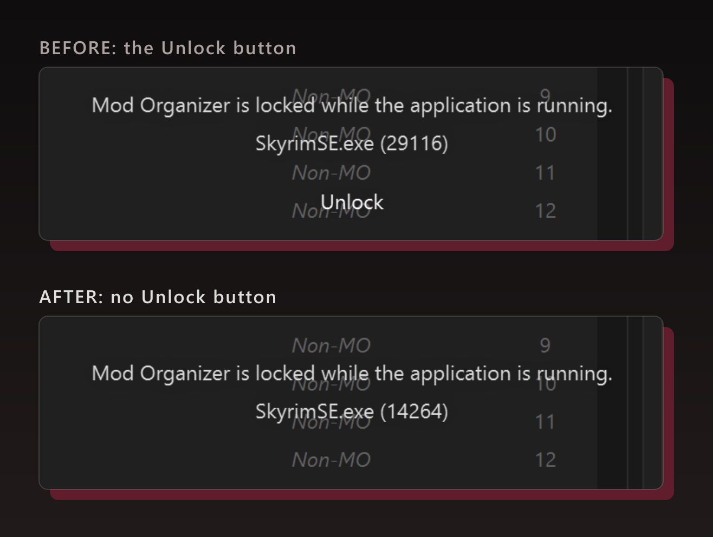
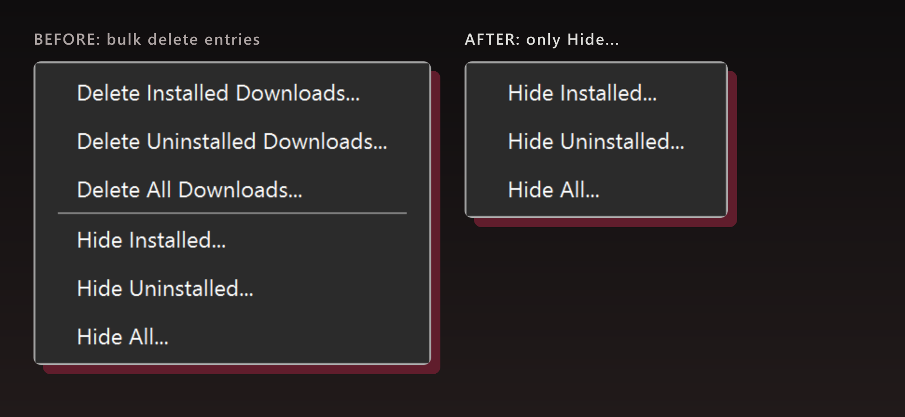

Hide the MO2 buttons you never use. Three editions, every option adjustable in MO2's own settings.

<picture>
  <source media="(prefers-color-scheme: dark)" srcset="docs/divider.png">
  
</picture>

## What it hides

- **Sort.** The plugin Sort button, which runs LOOT and can wreck a carefully ordered load order.
- **Manage Instances.** The Instance Manager button that sits where the manual install button used to be. If you run MO2 in Portable Mode this is already hidden by a portable.txt, so this only matters for other setups.
- **Unlock.** The button on MO2's locked screen that frees MO2 while the game is still running (the Unlock and Biggie editions).
- **Bulk delete downloads.** (Biggie Edition) Delete Installed, Uninstalled and All Downloads in the Downloads right-click menu. The menu for a single download is left alone.

## Pick an edition

- **Hide Buttons**: Manage Instances and Sort.
- **Unlock Edition**: the same, plus Unlock hidden for *every* program MO2 runs.
- **Biggie Edition**: the same, but Unlock is hidden *only* while the game or its script extender (SKSE, F4SE...) runs, so xEdit and other tools keep theirs. It also hides the bulk Delete Downloads entries. Thanks to biggieboss for the idea.

They are the same plugin with different starting options, so you can change any of it later without swapping files.

## Install

1. Close MO2.
2. Copy the `.py` file of **one** edition into MO2's `plugins` folder, replacing the old one.
3. Start MO2 again.

It needs Mod Organizer 2.5.2 or newer and nothing else. Don't install the download as a mod.
**Switching edition:** delete the old edition's `.py` first.

## Choose what it does

Everything is a tick box under **Settings › Plugins › Hide Buttons Plugin** (the edition's name follows it). There's one each for Manage Instances, Sort, Unlock, "only while the game runs" and the bulk delete entries, plus a box for extra program names that count as the game. Unlock and Downloads-menu changes apply at once; Sort and Manage Instances need an MO2 restart.

| Option | Plain / Unlock / Biggie start | Hides |
|---|---|---|
| `hide_instance_manager` | on / on / on | the Manage Instances button |
| `hide_sort` | on / on / on | the plugin Sort (LOOT) button |
| `hide_unlock` | off / on / on | the Unlock button on the "locked while a program runs" screen |
| `unlock_game_only` | on / off / on | limits the above to the game or its script extender (SKSE, F4SE...); xEdit etc. keep Unlock |
| `extra_game_exes` | empty | more program names that count as the game |
| `hide_bulk_delete` | off / off / on | Delete Installed / Uninstalled / All Downloads in the Downloads right-click menu |

## Good to know

- It only hides buttons, so anyone who knows where to look can still get to them. It's meant for tidy lists and stray clicks, not for security.
- MO2's *Exit Now* button is never touched.
- No background scanning. A quick check runs only while the locked screen is up, so Unlock can hide when SKSE hands over to the game.
- Tested live in a real Mod Organizer 2.5.2 with Skyrim Special Edition actually running. It reads the game from MO2, so other games should work, but I haven't watched Fallout 4's script extender in person.

Build it yourself

One source file, `src/HideButtons.py` (the plain edition), builds all three editions:

    python scripts/build_editions.py
    python scripts/build_release.py

The edition-specific part is one block marked `# ---- edition` near the top of the source; `build_editions.py` rewrites only that block, and never rename an edition's `NAME` after release (MO2 saves each plugin's settings under it). `scripts/verify_zips.py` checks the zips against the build.

How it works: MO2's window is searched once when it is ready, using the names MO2 gives its widgets (`sortButton`, `actionChange_Game`); the lock screen and the Downloads menu are caught when they appear, and while a lock screen is up a short check reads its "program.exe (pid)" line. MO2's own translations are used for button and menu names, so other languages work too.

Dev checks (nothing here ships in the plugin): `python -m venv .venv`, then `.venv\Scripts\python -m pip install -r requirements-dev.txt`.
- `pyright` checks the source and scripts (config in `pyrightconfig.json`).
- `.venv\Scripts\python -m pytest` runs the headless unit tests.
- `tests/live/` drives a real MO2 in a throwaway portable copy (`test-env/`, not in this repo): see the docstring in `tests/live/run_live.py`. It refuses to run while a game runs.

## Report a problem

Open an issue here, post in **Bugs** on the [Nexus page](https://www.nexusmods.com/site/mods/1619), or find me on [Discord](https://discord.gg/QZHymBYMxP). Please include your MO2 version and what you saw.

## More by sayngwyn

- **[Creations Browser](https://www.nexusmods.com/site/mods/2483)**: Browse Creations, download the free ones.
- **[Modlist Companion](https://www.nexusmods.com/skyrimspecialedition/mods/170511)**: Remembers every FOMOD choice you made in MO2.
- **[Sayngwyn Theme](https://www.nexusmods.com/site/mods/2487)**: My personal dark theme for MO2.

All my mods: [Nexus](https://www.nexusmods.com/profile/sayngwyn/mods) · [Website](https://sayngwyn.com/projects)

---

Made with AI. Claude contributed heavily under my direction: I decided what it does and checked it, and the AI wrote most of the code, its tests and these docs.

Thanks to biggieboss and LE2LV for the Biggie Edition ideas and requests, ellisalgernon for spotting the debug logging, and Ungeziefi for the portable.txt tip.

## Licence

MIT; see `LICENSE`. The sayngwyn skull mark in the header image (`docs/header.png`) is © sayngwyn, all rights reserved. It is not covered by this project's MIT licence and is included only in this README. Forks must remove or replace it.
